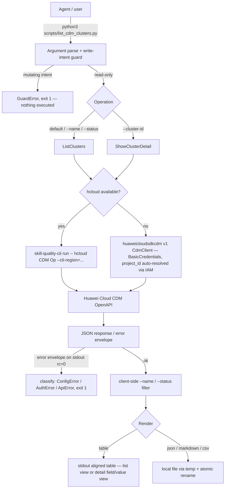

# Data Flow — huawei-cloud-cdm-list

Read-only guarantee: no branch constructs a mutating CDM operation (the only
argv ever built are `ListClusters` and `ShowClusterDetail`, both GET), and the
export writes only to the local filesystem.
