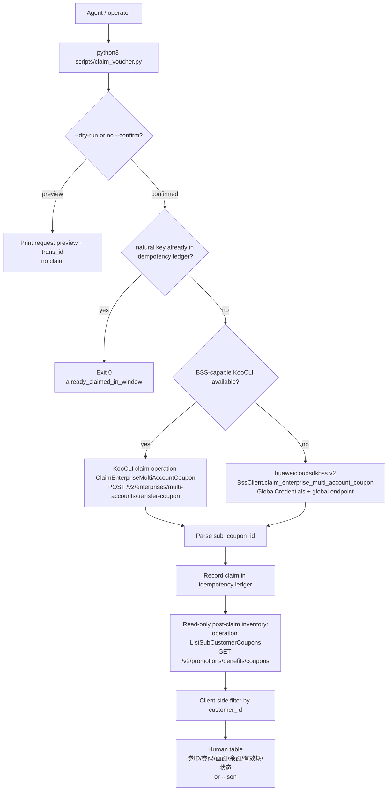

# Data Flow

Notes:

- The idempotency ledger is consulted **before** any API call, so a retry inside
  the window does not claim twice. The derived `trans_id` (customer_id |
  coupon_id | amount) additionally lets the server reject a duplicate submission
  (`CBC.99007009`).
- `--dry-run` (or a missing `--confirm`) prints the exact request and the derived
  `trans_id` without claiming anything and never touches the ledger.
- The post-claim inventory is read-only; `customer_id` has no server-side
  parameter and is applied client-side.
- Credentials are never part of the data flow of this script: the CLI path uses
  the active `hcloud` profile, the SDK path reads the standard environment
  variables via `config.py`.