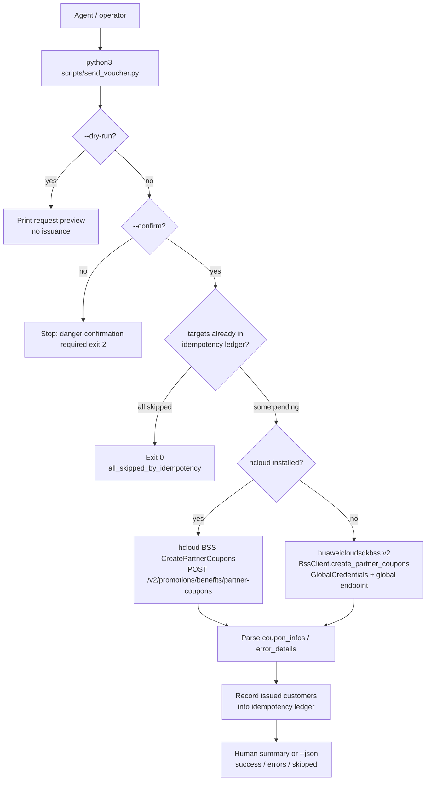

# Data Flow

Notes:

- The idempotency ledger is consulted **before** any API call, so a retry of a
  partially failed batch only sends the customers that were not yet issued.
- The `--dry-run` preview shows both the skipped and the pending targets and
  never touches the ledger.
- Credentials are never part of the data flow of this script: the CLI path uses
  the active `hcloud` profile, the SDK path reads the standard environment
  variables via `config.py`.