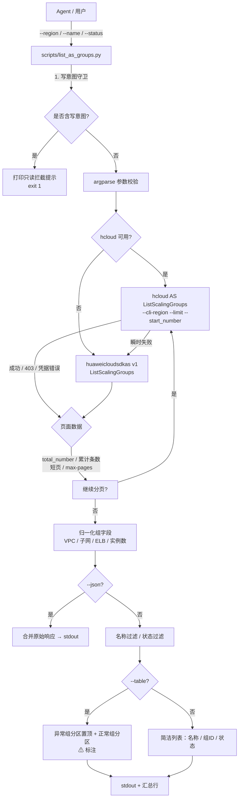
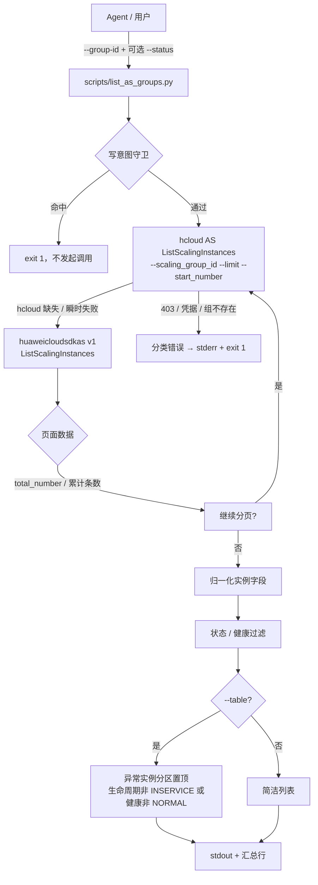

# 数据流图

## 1. 伸缩组列表（默认 / --table / --json）



## 2. 组内实例下钻（--group-id）



## 3. 判断口径

```text
异常伸缩组 = 状态 != INSERVICE  或  期望实例数 != 当前实例数
异常实例   = 生命周期状态 != INSERVICE  或  健康状态 != NORMAL

--status abnormal        → 只列异常资源
--status <状态值>        → 客户端精确匹配（组状态 / 实例生命周期 / 实例健康）
--json                   → 输出原始合并响应，不做客户端过滤
```