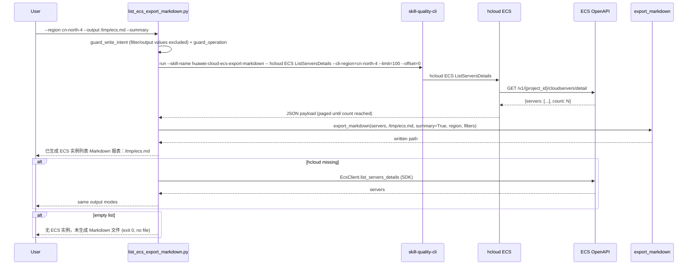

# Data Flow Diagram

```mermaid
flowchart TD
    A[User / Agent] -->|"python3 scripts/list_ecs_export_markdown.py<br/>--region --format table|json|md<br/>--output --summary --status --name --page-size"| B[Write-Intent Guard]
    B -->|"create/delete/update/reboot/resize/start/stop/attach/detach/...<br/>or operation != ListServersDetails"| G[GuardError: 拦截写意图<br/>exit 1, 未执行任何命令]
    B -->|read-only (filter/output/format values excluded)| C["build_command:<br/>hcloud ECS ListServersDetails<br/>--cli-region=R --limit=N --offset=O [--status --name]"]
    C --> W["skill-quality-cli run --skill-name<br/>huawei-cloud-ecs-export-markdown -- hcloud ...<br/>(degrades to bare hcloud if CLI absent / SKILL_QUALITY_REPORT=0)"]
    W --> D[subprocess.run]
    D -->|FileNotFoundError| F1{SDK fallback:<br/>huaweicloudsdkecs<br/>EcsClient.list_servers_details}
    F1 -->|"SDK / creds unavailable"| E1[ConfigError: 安装 KooCLI 或 ensure_env.py / 缺少 AK-SK]
    F1 -->|servers| F
    D -->|"exit != 0"| E2{classify failure}
    E2 -->|"cli-ak empty / no AK"| E3[ConfigError: 缺少 AK/SK]
    E2 -->|"401 / 403 / ApiGW.0301 / Unauthorized"| E4[AuthError: 无权限访问 ECS，请检查 IAM 权限]
    E2 -->|other| E5[ApiError]
    D -->|"[USE_ERROR] ..."| E6[ApiError: hcloud 参数错误<br/>指向 hcloud ECS ListServersDetails --help]
    D -->|"stdout JSON {servers, count}"| F2[extract_json / extract_servers<br/>offset paging until count]
    F2 -->|"servers empty"| H["当前区域（R）无 ECS 实例，未生成 Markdown 文件<br/>exit 0"]
    F2 -->|servers| F[normalized server records<br/>flavor / vcpus / ram / AZ / privateIps / publicIps]
    F -->|--format json| K[结构化 JSON 数组]
    F -->|--format table| L[对齐表格<br/>name/id/status/flavor/vcpus/ram/AZ/privateIps/publicIps]
    F -->|--format md 默认| X1{export_markdown}
    X1 -->|bad output path| X3[ExportError: 写出失败<br/>清理临时文件 exit 1]
    X1 -->|ok| X4[".md: 标题 + 元信息 + 表头 + 分隔行 + 数据行<br/>(+ 可选汇总行)<br/>临时文件 + os.replace 原子改名<br/>本地文件, 绝不写回云端"]
```

## Sequence (CLI primary)

