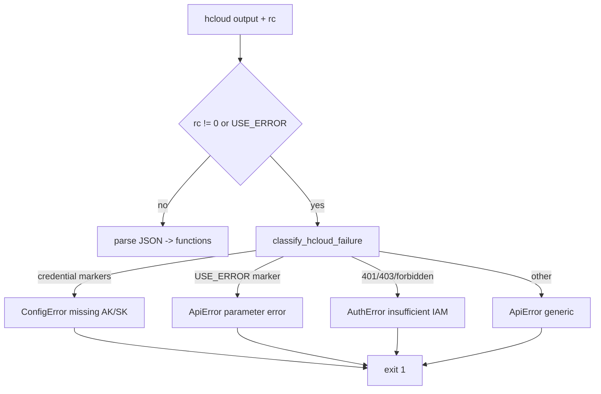

# Data Flow Diagram

## CLI primary path

```mermaid
flowchart TD
    A[User / Agent] -->|query: list functions, --region, --name, --package-name| B[python3 scripts/list_functiongraph.py]
    B --> C{Write-intent guard}
    C -->|mutating intent| X[GuardError - rejected, exit 1]
    C -->|read intent OK| D[build_command: hcloud functiongraph ListFunctions]
    D -->|hcloud missing| E[SDK fallback huaweicloudsdkfunctiongraph list_functions]
    D -->|SKILL_QUALITY_REPORT!=0| F[skill-quality-cli run -- hcloud functiongraph ListFunctions]
    F --> G[Huawei Cloud FunctionGraph OpenAPI GET /v2/project_id/fgs/functions]
    E --> G
    G -->|next_marker| D
    G --> H[parse JSON -> functions[]]
    H --> I[Sort by func_name]
    I --> J{Output mode}
    J -->|--names-only| K[name list]
    J -->|--json| L[raw JSON array]
    J -->|table default| M[aligned table: name/urn/memory/timeout/handler/runtime/package...]
```

`--project_id` is filled by KooCLI from the credential profile; the script never
emits it.

## Error classification flow


