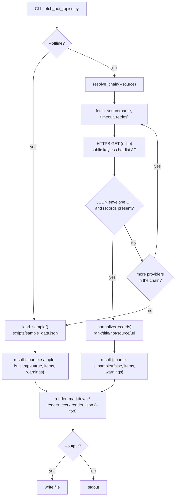

# Data Flow Diagram — huawei-cloud-daily-hot-topics

## Notes

- The provider chain is resolved first (`--source` pin, else the default chain).
- Each provider is tried with a bounded timeout and a small retry budget; the
  first non-empty, well-formed response wins.
- On total failure (or `--offline`) the bundled sample dataset is used and the
  result is flagged as sample data; failures are collected into `warnings`.
- Rendering applies the `--top` limit and produces Markdown / text / JSON, which
  is written to a file or to standard output.