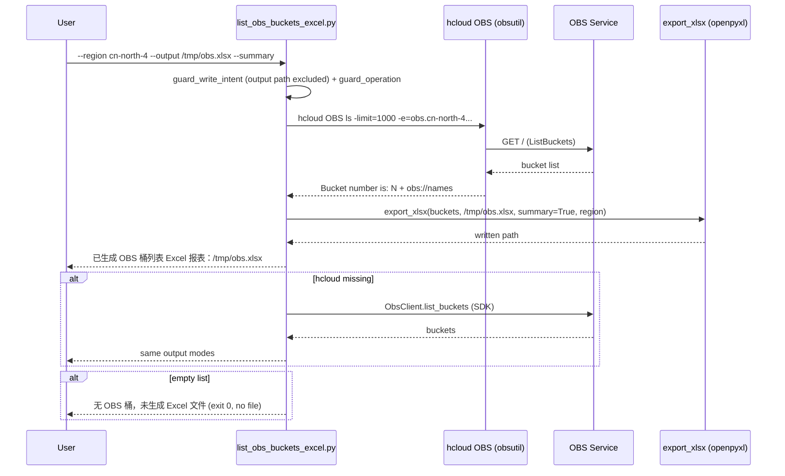

# Data Flow Diagram

```mermaid
flowchart TD
    A[User / Agent] -->|"python3 scripts/list_obs_buckets_excel.py<br/>--region --format table|json|xlsx<br/>--output --summary --page-size --endpoint"| B[Write-Intent Guard]
    B -->|"create/delete/upload/download/copy/remove/restore/sync/...<br/>or operation != ls"| G[GuardError: 拦截写意图<br/>exit 1, 未执行任何命令]
    B -->|read-only (output path excluded)| C["build_command:<br/>hcloud OBS ls<br/>-limit=N -e=obs.&lt;region&gt;.myhuaweicloud.com"]
    C --> D[subprocess.run hcloud]
    D -->|FileNotFoundError| F1{SDK fallback:<br/>huaweicloudsdkobs<br/>ObsClient.list_buckets}
    F1 -->|"SDK / creds unavailable"| E1[ConfigError: 安装 KooCLI 或 ensure_env.py / 缺少 AK-SK]
    F1 -->|buckets| F
    D -->|"exit != 0"| E2{classify failure}
    E2 -->|"please set ak, sk and endpoint"| E3[ConfigError: 缺少 AK/SK]
    E2 -->|"InvalidAccessKeyId / 401 / 403 / AccessDenied"| E4[AuthError: 无权限访问 OBS，请检查 IAM 权限]
    E2 -->|"other"| E5[ApiError]
    D -->|"[USE_ERROR] ..."| E6[ApiError: hcloud 参数错误<br/>指向 hcloud OBS ls --help]
    D -->|"stdout (obs:// names)"| F2[parse_cli_buckets<br/>name / date / location / storage_class / policy]
    F2 -->|"buckets empty"| H["当前账号（Region x）无 OBS 桶，未生成 Excel 文件<br/>exit 0"]
    F2 -->|buckets| F[normalized bucket records]
    F -->|--format json| K[结构化 JSON 数组]
    F -->|--format table| L[对齐表格<br/>name/creation_date/location/storage_class/policy]
    F -->|--format xlsx 默认| X1{export_xlsx via openpyxl}
    X1 -->|openpyxl missing| X2[ExportError: 提示运行 ensure_env.py<br/>exit 1, 无文件]
    X1 -->|bad output path| X3[ExportError: 写出失败<br/>清理临时文件 exit 1]
    X1 -->|ok| X4[.xlsx: 表头 + 数据行 + 可选汇总行<br/>本地文件, 绝不写回 OBS]
```

## Sequence (CLI primary)

